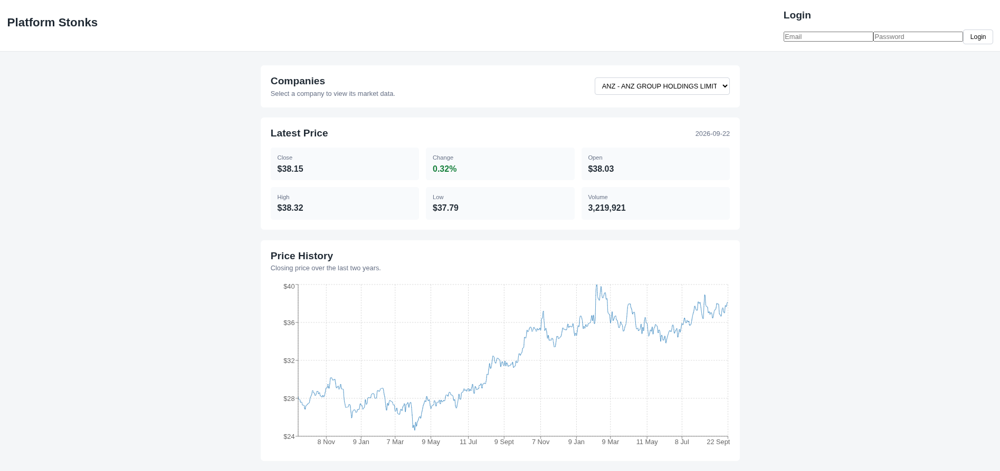
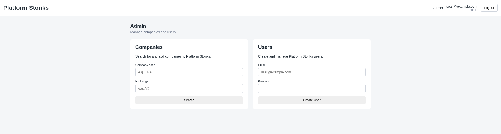
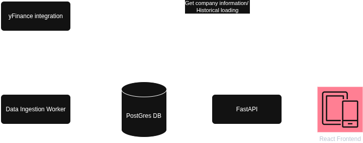

# Platform Stonks

## Overview

Platform Stonks is a personal project I created to develop a deeper understanding of software development and system design.

As a Business Analyst, I wanted to become more technically well-rounded by gaining hands-on experience with the technologies and concepts behind the systems I work with. The project has given me the opportunity to work across backend development, APIs, databases, frontend development, containerisation, authentication, automated jobs, testing, and system design.

I have also always had an interest in the stock market and invest in my own time, making a stock market platform a natural choice for applying these skills to a subject I am personally interested in.

## Features

- Stock search and onboarding
- Historical price ingestion
- Automated daily price updates
- Interactive price charts
- User authentication
- Role-based access control
- Exchange-aware data ingestion

## Screenshots

### Market Dashboard



The dashboard displays the latest OHLC market data, trading volume, daily price movement, and two years of historical closing prices.

### Administration



Administrators can search for and onboard new companies and create additional users.

## Tech Stack

### Backend

- Python
- FastAPI
- PostgreSQL
- SQLAlchemy
- Pydantic

### Frontend

- React
- TypeScript
- Vite
- Recharts

### Infrastructure

- Docker
- Docker Compose
- systemd

### Testing & Code Quality

- pytest
- Ruff
- Pyright
- Oxlint
- TypeScript compiler

## Architecture



Platform Stonks uses a containerised architecture consisting of a React frontend, FastAPI backend, PostgreSQL database, and a scheduled data ingestion worker.

The FastAPI backend handles user requests and communicates with yFinance for company searches and historical data ingestion. The scheduled data ingestion worker retrieves daily market data for active companies and stores the results in PostgreSQL.

## Project Structure

```text
platform_stonks/
├── database/       # Database schema and initialisation
├── deployment/     # Scheduling configuration for the daily worker
├── frontend/       # React and TypeScript user interface
├── integrations/   # External integrations, including yFinance
├── tests/          # Backend test suite
├── utils/          # Shared backend and worker functionality
├── web/            # FastAPI REST API
└── worker/         # Scheduled market data ingestion worker
```

## Getting Started

### Prerequisites

- Docker
- Docker Compose
- Git

### Environment Variables

Copy the example environment file:

```bash
cp .env.example .env
```

Configure the following environment variables:

| Variable | Description |
|---|---|
| `POSTGRES_USER` | PostgreSQL username |
| `POSTGRES_PASSWORD` | PostgreSQL password |
| `POSTGRES_DB` | PostgreSQL database name |
| `DATABASE_URL` | PostgreSQL connection string used by the application |
| `JWT_SECRET` | Secret used to sign authentication tokens |

Never commit your `.env` file or credentials to source control.

### Running with Docker

Clone the repository:

```bash
git clone <repository-url>
cd platform_stonks
```

Start the application:

```bash
docker compose up
```

### Accessing the Application

Once the containers are running:

- Frontend: `http://localhost:5173`
- FastAPI: `http://localhost:8000`
- API documentation: `http://localhost:8000/docs`

## API

The FastAPI backend provides endpoints for company management, historical pricing data, stock search, and user authentication.

### Companies

| Method | Endpoint | Description |
|---|---|---|
| `GET` | `/companies` | Return available companies |
| `GET` | `/companies/{code}/prices` | Return historical prices for a company |
| `GET` | `/company-search/{code}.{exchange}` | Search for a company |
| `POST` | `/companies/load` | Add and load a company |

### Users

| Method | Endpoint | Description |
|---|---|---|
| `POST` | `/user/create-user` | Create a user |
| `POST` | `/user/login` | Authenticate a user |
| `GET` | `/user/me` | Return the authenticated user's details |

Interactive API documentation is also available through FastAPI's `/docs` endpoint while the application is running.

## Background Worker

The data ingestion worker retrieves the latest price information for active companies.

Exchange configuration is stored in the database and is used to control market-specific behaviour. The current implementation provides the foundation for future multi-market scheduling, where workers can run according to the closing time of each supported exchange.

## Testing

### Backend

Run the backend test suite:

```bash
pytest
```

Run the test suite with coverage:

```bash
pytest --cov=utils --cov=web --cov=worker --cov-report=term-missing
```

Run linting:

```bash
ruff check .
```

Run static type checking:

```bash
pyright
```

### Frontend

From the `frontend` directory:

```bash
cd frontend
npm run lint
npm run build
```

## Current Limitations

The current release focuses on establishing the core platform and data pipeline. Some functionality has intentionally been left for future releases, including:

- Automated scheduling across multiple stock exchanges and time zones
- Portfolio and trade management
- Technical indicators
- Automated trading alerts
- Production deployment

## Roadmap

Planned future development includes:

- Portfolio and trade tracking
- Technical indicators
- Stock alerts
- Multi-market scheduling
- CI/CD pipeline
- Homelab production deployment
- Machine learning experimentation and forecasting

## Project Write-up

A more detailed write-up covering the design process, technical decisions, challenges, and lessons learned during the development of Platform Stonks will be published on my blog.

The README is intended to provide an overview of the application and instructions for running it, while the blog will explore the development process in greater depth.

## Author

**Sean Flight**

Business Analyst with an interest in software development, system design, data, and technology.
